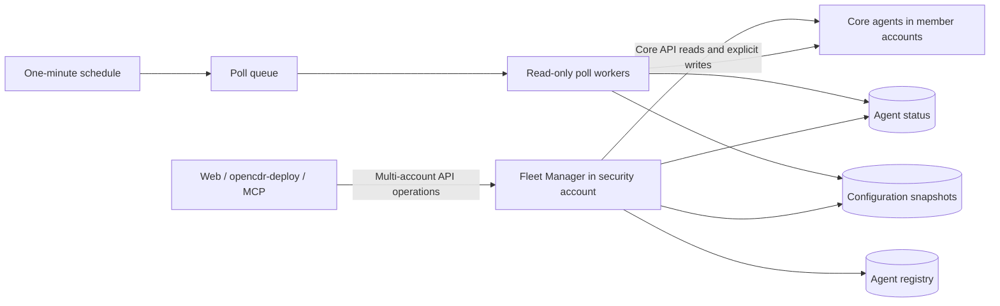

# OpenCDR Fleet Manager

An optional Serverless management service deployed in your organization's **AWS
security account**. Use it when managing multiple OpenCDR Core deployments.
Single-agent operators can continue connecting directly to Core.

Fleet Manager polls enabled agents every minute by default, caches their reported status and
configuration, independently collects durable detection feeds, and forwards explicitly requested API calls. It does not deploy
Core stacks, create cross-account IAM roles, execute its own incident response, or
continuously enforce a desired configuration. Core remains authoritative.



See [detection collection](docs/detection-collection.md) for cadence, receipt semantics,
metrics, recovery limits and remaining P1 acceptance. Central detection queries and a read-only web preview are implemented locally;
historical backfill, ownership migration and live acceptance remain pending.

## What is included

- A registry keyed by agent ID, with unique account/region/stage identities,
  enable/disable controls and revision-guarded updates.
- A status table with reported Core version, capabilities, security profile,
  archive/tracing flags when reported, evaluator state, timestamps, errors,
  polling request counts and API quota warnings.
- Complete paginated snapshots of rules, active reusable lists with their values,
  registered notification profiles, responder mappings, parser catalog and known
  integration bindings. Notification credentials are additionally redacted locally.
- Snapshot deduplication, chunking for large lists, pinned pagination and TTL
  expiration. Failed collections retain the last complete snapshot.
- A live, identity-checked Core API proxy, including a bounded multi-agent API.
  Agent HTTP status codes and partial-write details are preserved. Writes are not retried.
- Separate IAM roles for observation, configuration, response and administration.
  Legacy keys remain an explicit migration option.
- Durable reviewed rule rollouts with per-target outcomes and report-only drift.
- Generation-aware polling: unchanged configuration reuses a complete snapshot,
  with a full reconciliation hourly by default. Both intervals are configurable.
- AWS IAM/SigV4 authorization on every fleet API endpoint. No new IAM users or
  permanent AWS access keys are needed.
- Packaging from an explicit runtime allowlist, hashed Python dependencies,
  pinned Serverless tooling, CI and an account-checked deployment script.

This repository implements the service. OpenCDR Deploy provides its installed
operational CLI, and compatible web/MCP clients use explicit fleet connection
adapters. Existing direct-Core connections are never silently redirected.
Cases, triage, assignments and approvals are not migrated into this first release.

## Install the Python package

```bash
python -m pip install opencdr-fleet-manager
python -c "import opencdr_fleet; print(opencdr_fleet.__version__)"
```

The PyPI package provides the Python service modules. For AWS deployment and
operator commands, use the matching source release and the Serverless workflow
below. The source distribution also includes the deployment templates, operator
scripts and locked requirements.

## Install and manage the service

Use **OpenCDR Deploy 0.7.0+** as the user-facing CLI. It links to this repository
and manages the source checkout, locked build tools and Serverless deployment for
you. You can run it from any directory; no manual fleet-manager clone or `scripts/`
path is needed.

```bash
python -m pip install --upgrade 'opencdr-deploy>=0.7.0'
aws sso login --profile security-admin
opencdr-deploy fleet deploy security-prod \
  --profile security-admin --security-account-id 222222222222 \
  --region us-east-1 --stage prod \
  --package-only --output /tmp/opencdr-fleet-reviewed
```

Review `/tmp/opencdr-fleet-reviewed/cloudformation-template-update-stack.json`.
**`--package-only` builds local artifacts and does not create a stack.** Deploy
that exact package and check the live manager:

```bash
opencdr-deploy fleet deploy security-prod --artifact /tmp/opencdr-fleet-reviewed
opencdr-deploy fleet status --fleet security-prod
```

The CLI saves the API endpoint from CloudFormation outputs. Use `fleet connect`
with the endpoint/account/region/stage/profile to register an already deployed
manager, and `fleet list` to inspect saved managers.

Copy [examples/agent.json](examples/agent.json) to `agent.json` and set the real Core
account, region, stage and URL. Connect Fleet with `--access administrator`.
Prepare Core trust before registration:

```bash
aws sso login --profile member-admin
opencdr-deploy fleet agents bootstrap --fleet security-prod \
  --file agent.json --core-profile member-admin
# Apply the emitted exact role ARNs to Core through its reviewed deployment.
opencdr-deploy fleet agents register --fleet security-prod --file agent.json
opencdr-deploy fleet agents list --fleet security-prod
opencdr-deploy fleet agents show member-prod --fleet security-prod
opencdr-deploy fleet agents request member-prod GET '/rules?rule_kind=signal' --fleet security-prod
```

Use the actual `agent_id` from your document in place of `member-prod`. IAM is the
default: bootstrap creates no keys and emits the Core trust principals after
verifying both accounts. Start with `allow_writes: false`. See
[IAM management and rollouts](docs/iam-and-rollouts.md) for role boundaries,
reviewed releases and explicit legacy migration. Prebuilt deployment artifacts can
also be installed with `opencdr-deploy release`; source compilation remains a
maintainer and development workflow.

The complete setup, credential rotation, revision-guarded updates, configuration
pagination, Core API forwarding and explicit multi-agent calls are documented in
the [OpenCDR Deploy walkthrough](https://github.com/dbnz-io/opencdr-deploy#deploy-and-operate-fleet-manager).
IAM/SigV4 still protects every fleet route; see [access.md](docs/access.md).
The API contract remains [openapi.yml](openapi.yml). Manager responses retain
per-agent HTTP status, partial results and uncertain outcomes; HTTP 207 alone does
not prove that every target succeeded.

### Failed first deployment and small Lambda quotas

The default worker uses shared Lambda capacity with an SQS concurrency cap of 2,
without a fixed Lambda reservation. This supports accounts whose regional Lambda
quota starts at 10. Larger fleets can set `--poll-concurrency` after reviewing
their quota, other workloads and queue backlog. The cap does not reserve capacity.

If rollback removes the stack but leaves its retained DynamoDB tables, preserve
them and review `opencdr-deploy fleet recover` before retrying deployment. The
local recovery implementation imports retained tables and their paired evidence
bucket with a saved plan/digest, then keeps both poll schedules paused. See
Deploy's [storage recovery guide](../opencdr-deploy/docs/fleet-storage-recovery.md)
in the workspace. An existing failed stack requires review; the tool does not
delete stacks automatically. Replaced worker principals require the separate
[reviewed handoff](../opencdr-internal/docs/detection-handoffs.md) in this workspace.
PITR/feed replacement and live acceptance remain gates; import completion does
not imply collection readiness.

The Node `url.parse()` deprecation warning is separate from deployment success.
An older helper's `allowedAgentHosts=` error is fixed by omitting empty CLI
parameters. Always check the final packaging/deployment result. Package-only
success produces no CloudFormation stack outputs.

### Source/developer deployment

Contributors can still clone this repository, install `requirements.lock` and
`npm ci`, and use `python scripts/deploy.py` with the same account/profile/region/
stage guards. These are implementation helpers behind the installed CLI.
`--package-only` validates packaging without deploying; omit it for deployment.
Use the installed CLI's `--artifact` workflow when promoting an already reviewed
package. PyPI's `opencdr-fleet-manager` distribution contains the service Python
modules; `opencdr-deploy` is the operational console command.

## Configuration and operational limits

Health/configuration polling can be set to 1–60 minutes with
`--poll-interval-minutes`. Full refresh can be set to 1–1440 minutes with
`--full-refresh-minutes`, and must be at least the polling interval. For example:

```bash
opencdr-deploy fleet package security-prod \
  --poll-interval-minutes 5 --full-refresh-minutes 60
```

Review and deploy the resulting package using the existing artifact workflow.
Prebuilt `release plan` accepts the same options for compatible Fleet artifacts.
Defaults remain one minute and sixty minutes. Stale-status thresholds scale to
at least three polling intervals. Cache expiry can force an earlier full refresh;
cost estimates account for the selected cadence and retention.

These settings cover health and configuration only. A separate detection schedule
uses `--detection-poll-interval-minutes`; `/v1/status` reports the installed
`capabilities.detection_delivery` and that cadence. Fleet now collects signals
and correlations with atomic local receipts. Central query APIs and a browser preview are available locally;
backfill and live acceptance remain pending; see [detection collection](docs/detection-collection.md).
Unchanged configuration never suppresses detection collection.

`--pause-polling` disables the health/configuration schedule. Set `enabled: false` through a revision-
guarded registration update to pause one agent and disable forwarding to it.
The registry and last observations are retained; there is no destructive agent
deletion endpoint. An in-flight HTTP call may finish, but a disabled/changed
registration fences old poll workers from publishing a new snapshot.

`--security-profile hardened` opts the three fleet tables into PITR. Standard
uses encryption at rest and retained tables; both profiles use encrypted queues.
Tables have Retain/UpdateReplacePolicy Retain, so removing the stack leaves them
for explicit operator cleanup. Object Lock, AWS Backup and customer KMS keys are
not introduced. Changing profile, retention, allowed hosts or polling settings
uses the same deployment command with new flags and a reviewed Serverless package.

The configured schedule is a target cadence, not an exact freshness guarantee.
HTTP latency, retries and backlog affect observation age. Polls have a 40-second
collection budget, 200-page bounds per listing, and a 5,000-resource/20 MB snapshot
limit (2 MB per upstream HTTP response). Overflow or collection failure keeps the previous complete snapshot and
reports failure. Poll jobs older than thirty minutes are discarded. The queue is
limited to 2 concurrent poll workers by default, configurable with `--poll-concurrency`; monitor backlog before expanding a large fleet.

Only profiles named in `settings_ids` and bindings named in `integration_ids`
can be enumerated reliably: Core currently has no saved-profile/binding listing
endpoint. Default notification coverage is `global`. Rules, list membership and
responder mappings are fully paginated. Snapshots are complete collections with
resource revisions, not cross-resource database transactions. List revision and
rule catalog changes during collection abort publication.

Configuration snapshots default to 24-hour TTL retention (2–168 configurable
hours). Unchanged content is reused until near expiry, avoiding full cache writes
every minute. This reduces write/storage costs; agent API reads still happen on
every poll. Fleet does not copy logs or detection telemetry into these tables.
Cache rules and list values as sensitive operational data. Notification secret
fields are redacted, and API keys remain exclusively in SSM.

Default agent hosts must be the expected region's AWS execute-api domain. Custom
domains require an exact `--allowed-agent-hosts` list reviewed at deployment.
The fleet Lambdas must be able to reach those endpoints. Private-network access,
Core API exposure policies and client workload credentials remain deployment
choices. No member-account AWS role is assumed during normal fleet operation.

See [architecture](https://github.com/dbnz-io/opencdr-fleet-manager/blob/main/docs/architecture.md), [access](https://github.com/dbnz-io/opencdr-fleet-manager/blob/main/docs/access.md) and
[acceptance checks](https://github.com/dbnz-io/opencdr-fleet-manager/blob/main/docs/acceptance.md) before connecting production agents.

## Development

```bash
python -m pip install -e '.[dev]'
ruff check .
pytest
python scripts/package.py
```

`requirements.lock` includes wheel hashes for every runtime dependency. Review
version changes in `scripts/lock-runtime.py` before regenerating it. Builds include
only locked vendor files and `src/opencdr_fleet/*.py`; credentials, `.env`, Git
metadata, tests and workstation build artifacts cannot enter the Lambda ZIP.
CI validates Python 3.12–3.14 and packages the service. Deployment is operator-
controlled. A published GitHub release runs the dedicated PyPI workflow; no AWS
deployment is triggered by package publication.

## Publishing releases

The PyPI publisher uses short-lived GitHub OIDC credentials and the `pypi`
GitHub environment. It builds and checks the wheel and source distribution,
verifies the release tag matches the package version, then publishes those exact
artifacts. No PyPI API token is stored in GitHub.

For initial setup, add a pending publisher at
[PyPI account publishing](https://pypi.org/manage/account/publishing/):

| Field | Value |
| --- | --- |
| PyPI project | `opencdr-fleet-manager` |
| GitHub owner | `dbnz-io` |
| Repository | `opencdr-fleet-manager` |
| Workflow filename | `publish.yml` |
| Environment | `pypi` |

The first successful publication creates the PyPI project. For subsequent
releases, update `pyproject.toml`, `opencdr_fleet.__version__` and `package.json`
together, wait for validation, and publish a GitHub release named `v<version>`.
The initial release is `v0.1.0`. Package publication and AWS deployment are
separate operator actions.

Licensed under the [Mozilla Public License 2.0 (MPL-2.0)](https://github.com/dbnz-io/opencdr-fleet-manager/blob/main/LICENSE).


Reviewed [feed storage and consumer recovery](../opencdr-internal/docs/detection-feed-recovery.md)
is implemented locally through Deploy API commands: inspect physical binding,
review/apply generation rotation, complete retained-source backfill, then queue
Fleet replay with polling paused. This does not initiate AWS PITR or claim live
recovery acceptance.

Detection handling and triage access: see [operator notes](docs/detection-handling.md).

## Operational cases (P2 candidate)

The local candidate adds shared operational cases: Core owns standalone cases,
Fleet owns multi-account cases. Read `capabilities.operational_cases == "1.0.0"`
before using `/cases` (Core) or `/v1/cases` (Fleet). Create, edit, notes, verified
attachments, retained evidence, close/reopen and immutable history use IAM,
revision checks and stable request IDs. Cases track SIEM work; they do not run
investigations or change detection handling. Fleet requires explicit principal
account grants, even for administrators, and never fans out case reads to Core.

Use the [owner deployment/test and KPI guide](../opencdr-internal/docs/operational-cases.md) for grants, Deploy commands,
limits, failure scenarios and remaining live/retention/migration gates. This
candidate is locally tested; it has not been deployed or publicly promoted.

### P2 connector reports and selected outcome reads (candidate)

Fleet owns `/v1/cases/active`, `/v1/case-integrations/{id}`, and
`/v1/cases/{case_id}/external-status`. The active lookup requires the detection's
agent/ID and full selected case scope. Connector binding is administrator-only;
reports require the dedicated `management/integration` IAM entry point and a
matching immutable principal/account/origin binding. They never change local
case status or execute investigations. Case reads display current/error/stale/
disabled synchronization health separately. Reports and active lookup are local.

`GET /v1/agents/{id}/detections/outcomes` and `/history` are explicit reads from
one IAM Core advertising outcome history. They are not part of central list
fanout. Unavailable Core history stays unavailable. Use Deploy or the typed MCP
reader; the web preview loads observations on demand. The Core deployment and
assessment supplement is in `opencdr-internal/docs/case-connectors-and-outcomes.md`
in the coordinated workspace. No native SIEM adapter or live acceptance is claimed.

### P4–P6 local candidate (2026-11-11)

Owner review registry/inbox/decisions and owner-local routing previews are now
implemented locally. Fleet also negotiates complete saved-profile/binding
inventory with compatible Core agents. These changes are undeployed and are not
approval-enforced jobs or automatic case routing. See the coordinated
[implementation and CLI guide](../opencdr-internal/docs/p4-p6-local-implementation-2026-11-11.md)
for capabilities, limits, evidence and remaining acceptance gates.
