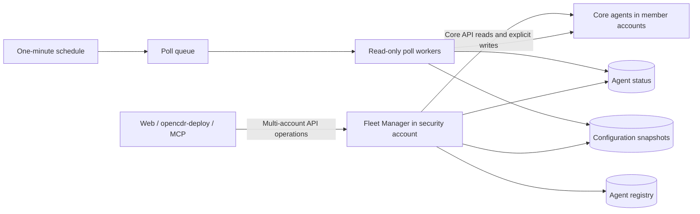

# OpenCDR Fleet Manager

An optional Serverless management service deployed in your organization's **AWS
security account**. Use it when managing multiple OpenCDR Core deployments.
Single-agent operators can continue connecting directly to Core.

Fleet Manager polls enabled agents every minute, caches their reported status and
configuration, and forwards explicitly requested API calls. It does not deploy
Core stacks, create cross-account IAM roles, execute its own incident response, or
continuously enforce a desired configuration. Core remains authoritative.



## What is included

- A registry keyed by agent ID, with unique account/region/stage identities,
  enable/disable controls and revision-guarded updates.
- A status table with reported Core version, capabilities, security profile,
  archive/tracing flags when reported, evaluator state, timestamps, errors,
  polling request counts and API quota warnings.
- Complete paginated snapshots of rules, active reusable lists with their values,
  registered notification profiles, responder mappings, parser catalog and known
  integration bindings. Notification credentials are additionally redacted locally.
- Snapshot deduplication, chunking for large lists, pinned pagination and TTL
  expiration. Failed collections retain the last complete snapshot.
- A live, identity-checked Core API proxy, including a bounded multi-agent API.
  Agent HTTP status codes and partial-write details are preserved. Writes are not retried.
- Separate read and write agent credentials in security-account SSM SecureString
  parameters. Poll workers cannot read write credentials.
- AWS IAM/SigV4 authorization on every fleet API endpoint. No new IAM users or
  permanent AWS access keys are needed.
- Packaging from an explicit runtime allowlist, hashed Python dependencies,
  pinned Serverless tooling, CI and an account-checked deployment script.

This repository implements the service and a signed operator client. The existing
web, opencdr-deploy and MCP applications still need their fleet connection adapters;
this repository does not silently redirect their existing direct-Core connections.
Cases, triage, assignments and approvals are not migrated into this first release.

## Install the Python package

```bash
python -m pip install opencdr-fleet-manager
python -c "import opencdr_fleet; print(opencdr_fleet.__version__)"
```

The PyPI package provides the Python service modules. For AWS deployment and
operator commands, use the matching source release and the Serverless workflow
below. The source distribution also includes the deployment templates, operator
scripts and locked requirements.

## Deploy into the security account

You need Python 3.12+, Node 22+, an AWS CLI/SSO profile with deployment permission
in the security account, and the Serverless Framework authentication required by
your organization. Use an existing role or IAM Identity Center profile.

```bash
git clone https://github.com/dbnz-io/opencdr-fleet-manager.git
cd opencdr-fleet-manager
python3 -m venv .venv
. .venv/bin/activate
python -m pip install --require-hashes -r requirements.lock
python -m pip install --no-deps -e .
npm ci

aws sso login --profile security-admin
aws sts get-caller-identity --profile security-admin
```

Check that the printed account is your security account. The account ID below is
an example; replace it with yours. This command creates AWS resources:

```bash
python scripts/deploy.py \
  --profile security-admin \
  --security-account-id 222222222222 \
  --region us-east-1 \
  --stage prod
```

The script refuses a mismatched AWS account, builds the hash-locked Lambda ZIP,
compiles the Serverless package and deploys that exact package. Use
`--package-only` to stop before deployment and review `.serverless/cloudformation-template-update-stack.json`.

Retrieve the API URL after `UPDATE_COMPLETE`/`CREATE_COMPLETE`:

```bash
aws cloudformation describe-stacks \
  --stack-name opencdr-fleet-manager-prod \
  --profile security-admin --region us-east-1 \
  --query 'Stacks[0].Outputs'
```

Copy **FleetManagerApiUrl**, including `/prod`, into the URL used below. With a
profile permitted to invoke the fleet API, test it:

```bash
python scripts/fleet.py --profile security-admin --region us-east-1 request \
  --url https://FLEET_API_ID.execute-api.us-east-1.amazonaws.com/prod \
  GET /v1/status
```

Expected: `product: OpenCDR Fleet Manager`, version `0.1.0` and
`poll_interval_seconds: 60`. The deployment profile may already be allowed to
invoke the API; operator profiles should receive the scoped permissions in
[access.md](https://github.com/dbnz-io/opencdr-fleet-manager/blob/main/docs/access.md).

## Connect an agent

Perform these steps once per Core deployment. An agent is identified by its
account **and** region **and** stage; two stages in one account are separate agents.

1. Copy `examples/agent.json` to `account-a.json`. Set the actual account ID,
   region, stage and Core API URL. Choose a stable `agent_id` such as
   `account-a-prod`. Keep `allow_writes: false` for read-only onboarding. No keys
   belong in this file.
2. Review the Core management API quota before enabling one-minute polling.
   The legacy 10,000/month quota is insufficient: even `/status` alone needs
   44,640 requests in a 31-day month. Full configuration polling needs more.
   The companion Core change adds `managementMonthlyRequestQuota`. This parameter
   requires a Core release containing that change; saving it against an older
   release does not change the usage plan. For older releases, raise the existing
   API Gateway usage-plan quota through your approved AWS configuration workflow
   before enabling polling. For a Core release supporting the parameter, for example,
   using your named Core installation:

   ```bash
   opencdr-deploy --deployment account-a-production features set \
     managementMonthlyRequestQuota=1000000
   ```

   This saves the local deployment parameter; follow your normal package/review/
   deploy procedure to apply it. It is not an API mutation. Select a quota using
   the observed `estimated_monthly_poll_requests`, plus headroom for operators
   and changing configuration sizes. Older Core versions do not report quota or
   archive/tracing state; Fleet marks those values unknown.
3. Sign in to the agent account's profile as well as the security account's
   profile. Prepare scoped API keys with the local onboarding tool:

   ```bash
   aws sso login --profile account-a-admin
   python scripts/bootstrap_agent.py \
     --security-profile security-admin --security-account-id 222222222222 \
     --region us-east-1 --fleet-stage prod \
     --core-profile account-a-admin --file account-a.json
   ```

   The tool verifies both profile account IDs. In the member account it creates
   or reuses a dedicated `...-api-key-fleet-read` key and attaches it to the
   existing Core API usage plan. It copies the value directly to security-account
   SSM, never displaying it. If `allow_writes` is true, it also prepares a separate
   operator key. The member-account profile needs API Gateway key/usage-plan
   management permissions; the security profile needs `ssm:PutParameter` on this
   fleet's credential prefix. Core scopes remain the enforcement boundary.
4. Register the reviewed document:

   ```bash
   python scripts/fleet.py --profile security-admin --region us-east-1 request \
     --url https://FLEET_API_ID.execute-api.us-east-1.amazonaws.com/prod \
     POST /v1/agents --file account-a.json
   ```

   Expected: HTTP 201, agent revision 1 and `refresh_queued: true`. A false queue
   result does not undo registration; the regular schedule will pick it up.
5. Check status after the first poll:

   ```bash
   python scripts/fleet.py --profile security-admin --region us-east-1 request \
     --url https://FLEET_API_ID.execute-api.us-east-1.amazonaws.com/prod \
     GET /v1/agents/account-a-prod
   ```

   Expected: `health: healthy`, `configuration_state: ready`, verified deployment
   identity and fresh status/configuration timestamps. A rule evaluator can still
   be `propagating`; Fleet never substitutes its own activation verdict.

If keys are managed separately, use `scripts/fleet.py ... credential --agent ...
--kind read --security-account-id ... --stage prod` to import one using hidden
input. To rotate, import a newly issued scoped key and confirm a successful poll
before disabling the old key. Disabling an agent does not revoke its API keys.

## Operate a fleet

All requests below use the same signed `scripts/fleet.py ... request --url ...`
prefix. Paths are versioned independently of Core:

The machine-readable contract is [openapi.yml](https://github.com/dbnz-io/opencdr-fleet-manager/blob/main/openapi.yml).

| Method | Path | Purpose |
| --- | --- | --- |
| GET | `/v1/status` | Fleet service liveness and version |
| GET | `/v1/agents` or `/v1/statuses` | Paginated registry joined with cached status |
| POST | `/v1/agents` | Register a deployment |
| GET / PUT | `/v1/agents/{id}` | Inspect / replace registration with `expected_rev` |
| POST | `/v1/agents/{id}/refresh` | Queue a read-only poll |
| GET | `/v1/agents/{id}/configuration` | Read a page from a complete cached snapshot |
| Core method | `/v1/agents/{id}/api/{core-path}` | Forward one live Core API request |
| POST | `/v1/fleet/read` | Explicit GET fan-out to 1–8 agents |
| POST | `/v1/fleet/invoke` | Explicit Core API fan-out to 1–8 agents |

Example cached configuration: `GET /v1/agents/account-a-prod/configuration?kind=list`.
Pass `next_token` from each response to continue. Snapshot cursors remain pinned
to their generation even when another poll completes.

Example live operation: `GET /v1/agents/account-a-prod/api/rules/runtime-status`.
The response wraps the agent result as `{status_code, body, agent_id, attempted}`.
Use the Core API's normal query parameters and JSON body on proxy routes.

For several agents, send `examples/read-fleet.json` to `/v1/fleet/read`. A bulk
request always returns an explicit per-agent result; HTTP 207 is not proof that
every target succeeded. The operator client returns a nonzero exit code when
any target fails. For large payloads, use individual agent proxy calls; a bulk
response can mark an individual `body_omitted` to remain within response limits,
while retaining its HTTP status and outcome.

To enable writes, prepare the operator credential, then PUT the complete agent
registration with `allow_writes: true` and `expected_rev` equal to its current
revision. Callers also need IAM permission for the write route. Forward the exact
`expected_rev` read from each agent; different agents can require different values,
so use their individual proxy routes when necessary. Fleet does not silently
rebase conflicts, roll back other targets, or retry an ambiguous response action.

## Configuration and operational limits

`--pause-polling` disables the schedule. Set `enabled: false` through a revision-
guarded registration update to pause one agent and disable forwarding to it.
The registry and last observations are retained; there is no destructive agent
deletion endpoint. An in-flight HTTP call may finish, but a disabled/changed
registration fences old poll workers from publishing a new snapshot.

`--security-profile hardened` opts the three fleet tables into PITR. Standard
uses encryption at rest and retained tables; both profiles use encrypted queues.
Tables have Retain/UpdateReplacePolicy Retain, so removing the stack leaves them
for explicit operator cleanup. Object Lock, AWS Backup and customer KMS keys are
not introduced. Changing profile, retention, allowed hosts or polling settings
uses the same deployment command with new flags and a reviewed Serverless package.

The one-minute schedule is a target cadence, not an exact freshness guarantee.
HTTP latency, retries and backlog affect observation age. Polls have a 40-second
collection budget, 200-page bounds per listing, and a 5,000-resource/20 MB snapshot
limit (2 MB per upstream HTTP response). Overflow or collection failure keeps the previous complete snapshot and
reports failure. Poll jobs older than thirty minutes are discarded. The queue is
limited to 20 concurrent workers; monitor backlog before expanding a large fleet.

Only profiles named in `settings_ids` and bindings named in `integration_ids`
can be enumerated reliably: Core currently has no saved-profile/binding listing
endpoint. Default notification coverage is `global`. Rules, list membership and
responder mappings are fully paginated. Snapshots are complete collections with
resource revisions, not cross-resource database transactions. List revision and
rule catalog changes during collection abort publication.

Configuration snapshots default to 24-hour TTL retention (2–168 configurable
hours). Unchanged content is reused until near expiry, avoiding full cache writes
every minute. This reduces write/storage costs; agent API reads still happen on
every poll. Fleet does not copy logs or detection telemetry into these tables.
Cache rules and list values as sensitive operational data. Notification secret
fields are redacted, and API keys remain exclusively in SSM.

Default agent hosts must be the expected region's AWS execute-api domain. Custom
domains require an exact `--allowed-agent-hosts` list reviewed at deployment.
The fleet Lambdas must be able to reach those endpoints. Private-network access,
Core API exposure policies and client workload credentials remain deployment
choices. No member-account AWS role is assumed during normal fleet operation.

See [architecture](https://github.com/dbnz-io/opencdr-fleet-manager/blob/main/docs/architecture.md), [access](https://github.com/dbnz-io/opencdr-fleet-manager/blob/main/docs/access.md) and
[acceptance checks](https://github.com/dbnz-io/opencdr-fleet-manager/blob/main/docs/acceptance.md) before connecting production agents.

## Development

```bash
python -m pip install -e '.[dev]'
ruff check .
pytest
python scripts/package.py
```

`requirements.lock` includes wheel hashes for every runtime dependency. Review
version changes in `scripts/lock-runtime.py` before regenerating it. Builds include
only locked vendor files and `src/opencdr_fleet/*.py`; credentials, `.env`, Git
metadata, tests and workstation build artifacts cannot enter the Lambda ZIP.
CI validates Python 3.12–3.14 and packages the service. Deployment is operator-
controlled. A published GitHub release runs the dedicated PyPI workflow; no AWS
deployment is triggered by package publication.

## Publishing releases

The PyPI publisher uses short-lived GitHub OIDC credentials and the `pypi`
GitHub environment. It builds and checks the wheel and source distribution,
verifies the release tag matches the package version, then publishes those exact
artifacts. No PyPI API token is stored in GitHub.

For initial setup, add a pending publisher at
[PyPI account publishing](https://pypi.org/manage/account/publishing/):

| Field | Value |
| --- | --- |
| PyPI project | `opencdr-fleet-manager` |
| GitHub owner | `dbnz-io` |
| Repository | `opencdr-fleet-manager` |
| Workflow filename | `publish.yml` |
| Environment | `pypi` |

The first successful publication creates the PyPI project. For subsequent
releases, update `pyproject.toml`, `opencdr_fleet.__version__` and `package.json`
together, wait for validation, and publish a GitHub release named `v<version>`.
The initial release is `v0.1.0`. Package publication and AWS deployment are
separate operator actions.

Licensed under the [Mozilla Public License 2.0 (MPL-2.0)](https://github.com/dbnz-io/opencdr-fleet-manager/blob/main/LICENSE).
